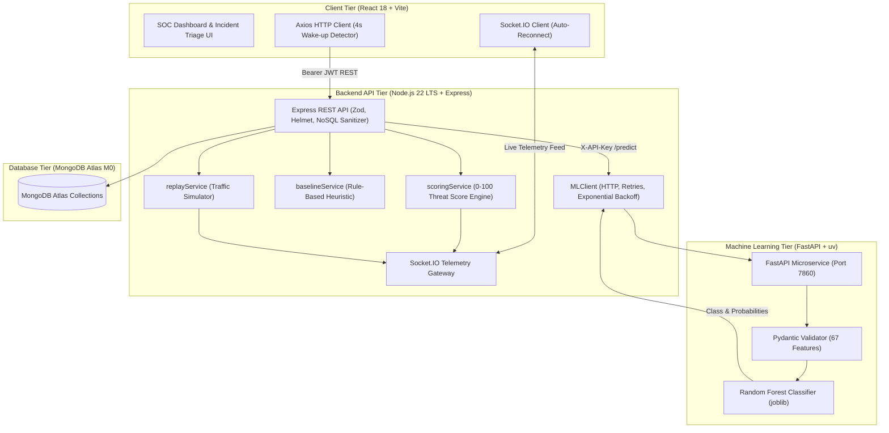

# AI CyberShield: Intelligent Cyberattack Detection and Threat Analysis System

[](https://nodejs.org/)
[](https://react.dev/)
[](https://fastapi.tiangolo.com/)
[](https://python.org/)
[](https://github.com/astral-sh/uv)
[](https://www.mongodb.com/atlas)
[](https://tailwindcss.com/)
[](https://github.com/)
[](LICENSE)

> **B.Tech Major Project** in Computer Science & Engineering  
> **Institution:** Dev Bhoomi Uttarakhand University  
> **Academic Session:** 2026-2027  

AI CyberShield is an end-to-end cybersecurity intelligence platform designed to classify network-flow traffic records into attack categories (`DoS/DDoS`, `PortScan`, `BruteForce`) versus `Benign` traffic. The platform calculates a transparent, mathematically explainable 0–100 threat severity score, records security incidents, streams telemetry to a live Security Operations Center (SOC) dashboard, and benchmarks the machine learning classifier against a domain-standard rule-based heuristic baseline on identical test data.

---

## Live Deployments & Demo Links

| Service | Hosting Platform | URL | Status |
| :--- | :--- | :--- | :--- |
| **SOC Web Client** | Vercel (Edge CDN) | `https://ai-cybershield.vercel.app` *(Placeholder)* | Production Ready |
| **Express API Server**| Render (Free Tier) | `https://ai-cybershield-server.onrender.com` *(Placeholder)* | Production Ready |
| **ML Inference Service**| Hugging Face Spaces | `https://<user>-ai-cybershield-ml.hf.space` *(Placeholder)* | Production Ready |
| **Interactive API Docs**| Render / Express | `https://ai-cybershield-server.onrender.com/api/docs` | OpenAPI 3.0 (Admin) |

---

## User Interface & Screenshots

| SOC Monitoring Dashboard | Forensic Incident Triage |
| :---: | :---: |
|  *(Real-time KPI cards, timeline, distributions, throttled live feed)* |  *(Explainable 0-100 threat score, factor breakdown, notes)* |

| Comparative Evaluation (ML vs Baseline) | Ingestion & Traffic Replay |
| :---: | :---: |
|  *(Accuracy delta, confusion matrix heatmap, discrepancy analysis)* |  *(Drag-and-drop CSV validation, 1-50 fps traffic simulator)* |

---

## System Architecture



---

## Key Features

1. **Machine Learning Attack Classification:**
   - Classifies 67 bidirectional flow features into `DoS/DDoS`, `PortScan`, `BruteForce`, or `Benign`.
   - Selected Champion: **Random Forest Ensemble** achieving **98.00% Accuracy** and **0.9802 Macro F1** on held-out CIC-IDS2017 test splits.
2. **Transparent 0–100 Threat Severity Scoring:**
   - Pure, deterministic calculation: $\text{Score} = \operatorname{round}(100 \times (0.6 \times S_{\text{class}} + 0.4 \times C))$.
   - Satisfies the *Factor Conservation Invariant*: severity contribution + confidence contribution strictly sum to the final score.
   - Categorized into operational risk bands: `Low` (0–29), `Medium` (30–59), `High` (60–79), `Critical` (80–100).
3. **Objective Baseline Benchmark:**
   - Implements a domain-calibrated Rule-Based Heuristic baseline evaluating identical flow records.
   - Demonstrates empirical proof of ML superiority: **+36.00% Accuracy gain** and **+51.07% Macro F1 advantage** over static rules.
4. **Live SOC Telemetry & Throttled Streaming:**
   - Real-time event broadcasting over Socket.IO with auto-reconnection and role-based channels.
   - Live stream panel with 250ms batch rendering and a 50-item buffer cap to prevent browser re-render storms during high-speed traffic.
5. **Interactive Network Traffic Replay:**
   - Built-in traffic simulator streaming flows at 1–50 flows/sec from real ingested CSV datasets without executing offensive network scans.
6. **Accessible Dark SOC Interface:**
   - Styled using custom Ember Studio design tokens (warm terracotta and slate palette) optimized for operator fatigue resistance.
   - Multi-modal risk indicators (semantic icons + contrast borders + text labels) verified with **0 accessibility violations** (`axe-core`, WCAG 2.1 AA).
7. **Enterprise Defensive Security:**
   - Passwords hashed with bcrypt (cost 12), pre-computed dummy hash timing defense, 5-failure lockout (15 min).
   - Role-Based Access Control (`Admin`, `Analyst`, `Viewer`) with self-demotion prevention and role-based IP masking.
   - Strict Zod validation, NoSQL injection prevention, CSV executable magic-byte sniffing, and formula injection escaping in CSV exports.

---

## Tech Stack

| Layer | Technologies |
| :--- | :--- |
| **Frontend** | React 18, Vite 5, Tailwind CSS 3.4, Recharts, Lucide Icons, Socket.IO Client, TanStack Query, React Hook Form + Zod |
| **Backend API** | Node.js 22 LTS, Express 4.21, Mongoose 8, Socket.IO 4.8, Zod, Helmet, Pino, Bcrypt, JsonWebToken |
| **ML Microservice** | Python 3.11, FastAPI, Uvicorn, Scikit-Learn 1.6, Pydantic 2, Joblib, SlowAPI, managed with `uv` |
| **ML Training** | Python 3.11, Pandas, NumPy, Scikit-Learn, Matplotlib, Seaborn, Pip-Audit, managed with `uv` |
| **Database** | MongoDB Atlas M0 Shared Sandbox (512MB) with Compound Index Optimization (`IXSCAN`) |
| **Testing** | Vitest, Supertest, MongoMemoryServer, React Testing Library, Axe-Core, Pytest |
| **Cloud Hosting** | Vercel (Client SPA), Render (API Web Service), Hugging Face Spaces (Dockerized ML Microservice) |

---

## Monorepo Layout

```text
ai-cybershield/
├── client/                 # React 18 + Vite frontend SPA
│   ├── src/
│   │   ├── components/     # Accessible shared UI library (Button, Modal, Table, Badges)
│   │   ├── features/       # Feature modules: auth, dashboard, incidents, datasets, evaluation, admin
│   │   ├── services/       # Axios API client, Socket.IO manager
│   │   └── tests/          # Vitest + React Testing Library + axe-core tests
│   └── vercel.json         # SPA rewrites & Content Security Policy
├── server/                 # Node.js 22 + Express API server
│   ├── src/
│   │   ├── config/         # Zod environment validation, Mongoose connection
│   │   ├── controllers/    # Route controllers (auth, incidents, datasets, replay, eval)
│   │   ├── middlewares/    # Helmet, CORS, NoSQL sanitizer, RBAC, error handling
│   │   ├── models/         # Mongoose schemas: User, Incident, Dataset, AuditLog, Notification
│   │   ├── routes/         # REST routers (/api/auth, /api/detect, /api/incidents, /api/docs)
│   │   ├── scripts/        # ensureIndexes.js, seedAdmin.js, verifyPhase10Stack.js
│   │   ├── services/       # scoringService, baselineService, detectionService, replayService
│   │   └── sockets/        # Socket.IO connection manager & role rooms
│   └── tests/              # 14 Vitest integration test suites (110 tests)
├── ml-service/             # FastAPI ML inference microservice
│   ├── app/                # FastAPI application, Pydantic schemas, inference routes
│   ├── artifacts/          # Serialized Random Forest model & feature schema (78 KB)
│   ├── tests/              # Pytest test suite
│   ├── Dockerfile          # Hugging Face Spaces Docker container specification
│   └── pyproject.toml      # Python dependencies pinned via uv.lock
├── ml-training/            # Offline model training & dataset tooling
│   ├── sample/             # Demo dataset (demo_flows.csv)
│   ├── scripts/            # Dataset sampler and offline trainer
│   └── src/                # Modular training pipeline, feature cleaning, baseline heuristic
├── docs/                   # Comprehensive technical documentation & runbooks
├── scripts/                # smokeTest.ps1 post-deployment automation
├── render.yaml             # Render Blueprint Infrastructure-as-Code specification
└── .github/workflows/ci.yml # GitHub Actions Continuous Integration pipeline
```

---

## Local Development Setup

### Prerequisites
- **Node.js:** `v22.x LTS` installed (e.g. via fnm or nvm)
- **Python:** `3.11` installed
- **uv:** Astral `uv` Python package manager installed
- **MongoDB:** Local MongoDB instance running on `localhost:27017` (or free MongoDB Atlas M0 cluster URI)

### Quickstart (Four Terminals)

#### Terminal 1: Machine Learning Inference Microservice
```powershell
cd ml-service
uv sync --frozen
uv run uvicorn app.main:app --host 127.0.0.1 --port 7860 --reload
# Verify: http://localhost:7860/health -> {"status": "healthy"}
```

#### Terminal 2: Backend Express API Server
```powershell
cd server
npm install
# Create local .env from example if not already present
Copy-Item .env.example .env

# Provision compound MongoDB database indexes
npm run ensure-indexes

# Seed initial system administrator
npm run seed-admin

# Start development server with file watching
npm run dev
# Server online: http://localhost:5000 | Interactive Docs: http://localhost:5000/api/docs
```

#### Terminal 3: Frontend Web Client
```powershell
cd client
npm install
# Start Vite development server
npm run dev
# Web application available: http://localhost:5173
```

#### Terminal 4 (Optional): Offline ML Pipeline
```powershell
cd ml-training
uv sync --frozen
uv run python -m src.train --dataset sample/demo_flows.csv --out-dir artifacts
```

---

## Environment Variables Matrix

| Subproject | Variable Name | Required | Default / Example Value | Purpose |
| :--- | :--- | :---: | :--- | :--- |
| **server** | `NODE_ENV` | Yes | `development` / `production` | Execution environment |
| **server** | `PORT` | No | `5000` (Render uses `10000`) | Server HTTP port |
| **server** | `CLIENT_URL` | Yes | `http://localhost:5173` | Allowed CORS & WebSocket origin |
| **server** | `MONGO_URI` | Yes | `mongodb://localhost:27017/cybershield` | MongoDB connection string |
| **server** | `JWT_SECRET` | Yes | `[32+ character random string]` | Secret for signing HS256 tokens |
| **server** | `JWT_EXPIRES_IN` | No | `1h` | Token expiration duration |
| **server** | `ML_SERVICE_URL` | Yes | `http://localhost:7860` | URL of FastAPI microservice |
| **server** | `ML_API_KEY` | Yes | `[Secret matching ML Service]` | Internal microservice API key |
| **server** | `ADMIN_EMAIL` | Prod | `admin@cybershield.org` | Initial administrator email |
| **server** | `ADMIN_PASSWORD` | Prod | `SuperSecureAdmin2026!` (min 12) | Initial administrator password |
| **client** | `VITE_API_URL` | Yes | `http://localhost:5000` | Backend API base URL |
| **client** | `VITE_APP_ENV` | No | `development` / `production` | Frontend application mode |
| **ml-service** | `ML_API_KEY` | Yes | `[Secret matching Server]` | Inbound authorization key |

---

## Running Tests & Code Quality

The monorepo contains a comprehensive automated test suite with **200 passed tests across 27 test files**:

```powershell
# 1. Server Tests (Vitest + Supertest against in-memory MongoDB)
cd server
npm test
npm run lint

# 2. Client Tests (Vitest + React Testing Library + axe-core accessibility)
cd ../client
npm test
npm run lint
npm run build

# 3. ML Inference Microservice Tests (Pytest)
cd ../ml-service
uv run pytest
uv run ruff check .

# 4. ML Offline Training Pipeline Tests (Pytest)
cd ../ml-training
uv run pytest
uv run ruff check .
```

---

## Post-Deployment Smoke Test

To verify a live staging or production deployment across Vercel, Render, and Hugging Face:

```powershell
.\scripts\smokeTest.ps1 `
  -ServerUrl "https://ai-cybershield-server.onrender.com" `
  -ClientUrl "https://ai-cybershield.vercel.app" `
  -MlServiceUrl "https://<user>-ai-cybershield-ml.hf.space" `
  -AdminEmail "admin@cybershield.org" `
  -AdminPassword "SuperSecureAdmin2026!"
```

---

## Ethics & Educational Safety Statement

> [!IMPORTANT]
> **Strict Educational Prototype Policy:**
> - AI CyberShield is developed strictly for educational demonstration and academic research at Dev Bhoomi Uttarakhand University.
> - The software contains **zero offensive capabilities**: it performs no live port scanning, executes no denial-of-service floods, launches no brute-force attacks, and does not conduct unauthorized network probing.
> - Telemetry analysis and traffic replay operate exclusively on **public benchmark datasets** (CIC-IDS2017) and synthetic sample records.
> - The system does not implement automated firewall blocking or packet dropping, avoiding operational disruption to host networks.

---

## Technical Limitations

1. **Bidirectional Flow Completion Dependency:** Flow-based features (NetFlow statistics) require an active network flow to terminate or hit an inactivity timeout before extraction. This makes flow-based machine learning ideal for telemetry triage and rapid incident forensics rather than inline, sub-microsecond packet filtering.
2. **Synthetic Dataset Conditions:** CIC-IDS2017 reflects laboratory conditions from 2017. Real-world enterprise environments feature higher class imbalance (>99.9% benign) and modern evasion patterns requiring continuous retraining.
3. **Free-Tier Cold Starts:** Deployed on Render and Hugging Face free tiers, backend services sleep after periods of inactivity. An in-app 4.0-second cold-start detector and 5-minute keep-alive pings mitigate this during live demonstrations.

---

## License

This project is licensed under the **MIT License** - see the [LICENSE](LICENSE) file for details.
