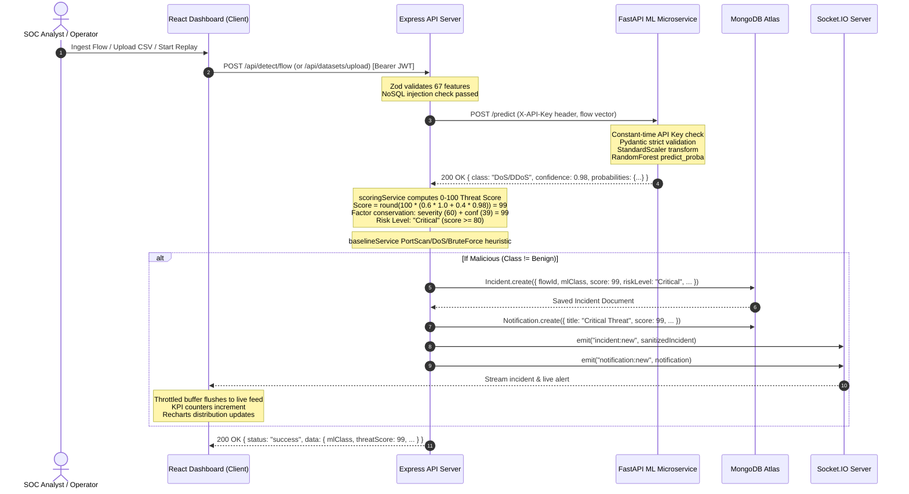
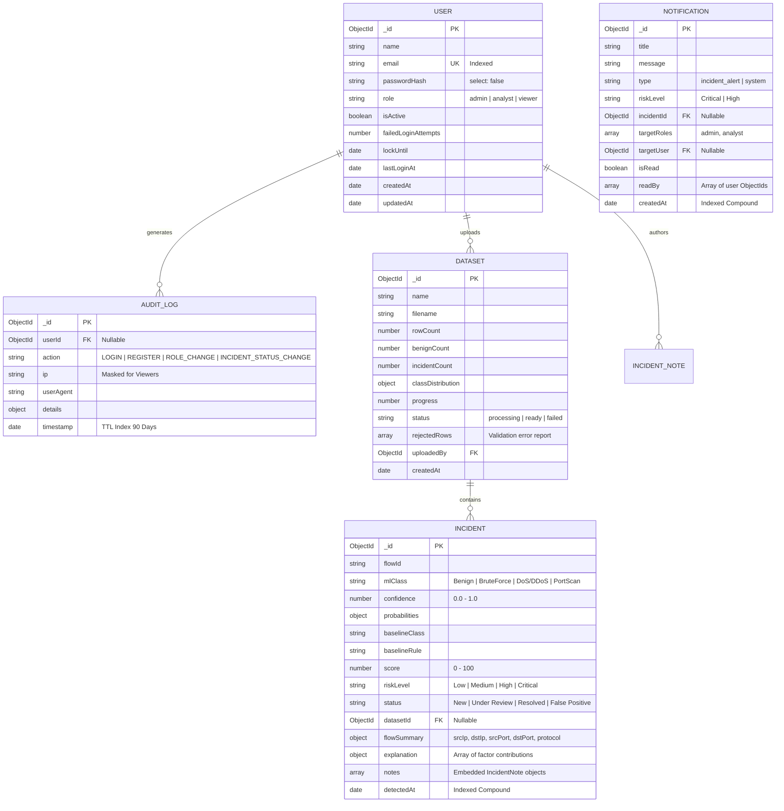

# System Architecture Specification

## 1. System Overview
**AI CyberShield** is an intelligent, educational cyberattack detection and threat analysis platform. It classifies bidirectional network flow records (CIC-IDS2017) into malicious classes (`DoS/DDoS`, `PortScan`, `BruteForce`) versus `Benign` traffic, computes a transparent 0–100 threat severity score with factor attribution, manages security incidents, and streams real-time telemetry to an operator SOC dashboard.

---

## 2. Component Architecture

```mermaid
flowchart TD
  subgraph ClientTier ["Frontend Client Tier (React 18 + Vite)"]
    UI["SOC Dashboard & Incident Triage UI"]
    SocketClient["Socket.IO Client (Auto-Reconnect)"]
    AxiosClient["Axios HTTP Client (4s Wakeup Detector)"]
    AuthContext["Auth Context (Memory + SessionStorage)"]
  end

  subgraph GatewayTier ["Backend API Tier (Node.js 22 LTS + Express)"]
    Router["Express Router (/api, /api/v1)"]
    SecurityMW["Security Pipeline (Helmet, CORS, NoSQL Sanitizer, Zod)"]
    AuthMW["Auth & RBAC Middleware (JWT HS256)"]
    DetectionService["detectionService (Flow Orchestrator)"]
    ScoringService["scoringService (0-100 Mathematical Engine)"]
    BaselineService["baselineService (Rule-Based Heuristic)"]
    ReplayService["replayService (Traffic Simulator)"]
    SocketGateway["Socket.IO Telemetry Gateway"]
    MLClient["MLClient (HTTP, Retries, Exponential Backoff)"]
  end

  subgraph MLTier ["Machine Learning Microservice (FastAPI + Python 3.11)"]
    FastAPIApp["FastAPI REST App (Port 7860)"]
    AuthHeader["X-API-Key Validator (hmac.compare_digest)"]
    PydanticValidator["Pydantic Feature Validator (67 Features)"]
    SklearnPipeline["scikit-learn Inference Pipeline"]
    Artifacts["Model Artifacts (model.joblib, preprocessor.joblib)"]
  end

  subgraph DataTier ["Persistence Tier (MongoDB Atlas M0)"]
    IncidentsCol[("incidents Collection")]
    UsersCol[("users Collection")]
    DatasetsCol[("datasets Collection")]
    AuditLogsCol[("audit_logs Collection")]
    NotificationsCol[("notifications Collection")]
  end

  AxiosClient -->|REST Requests (Bearer JWT)| Router
  SocketClient <-->|Realtime Socket Telemetry| SocketGateway
  Router --> SecurityMW
  SecurityMW --> AuthMW
  AuthMW --> DetectionService
  AuthMW --> ReplayService

  DetectionService -->|Predict Request (X-API-Key)| MLClient
  MLClient -->|HTTP POST /predict| FastAPIApp
  FastAPIApp --> AuthHeader
  AuthHeader --> PydanticValidator
  PydanticValidator --> SklearnPipeline
  SklearnPipeline --> Artifacts
  SklearnPipeline -->|Class & Probabilities| MLClient
  MLClient --> DetectionService

  DetectionService --> ScoringService
  DetectionService --> BaselineService
  DetectionService -->|Persist Incident| IncidentsCol
  DetectionService -->|Broadcast incident:new| SocketGateway
  SocketGateway --> SocketClient

  ReplayService --> DetectionService
  Router --> IncidentsCol
  Router --> UsersCol
  Router --> DatasetsCol
  Router --> AuditLogsCol
  Router --> NotificationsCol
```

---

## 3. End-to-End Detection Sequence Diagram

The following sequence illustrates the complete lifecycle of a network flow ingestion, machine learning inference, transparent threat scoring, database persistence, and WebSocket broadcast:



---

## 4. Data Model Entity-Relationship Diagram



---

## 5. Threat Scoring Architecture & Mathematical Proof

The threat scoring engine (`server/src/services/scoringService.js`, configured in `server/src/config/scoring.js`) implements a deterministic, fully explainable scoring model.

### 5.1 Formulation
$$\text{Score} = \min\left(100, \max\left(0, \operatorname{round}\left(100 \times \left(w_{\text{class}} \times S_{\text{class}} + w_{\text{conf}} \times C\right)\right)\right)\right)$$

Where:
- $w_{\text{class}} = 0.6$ (weight allocated to attack category inherent severity)
- $w_{\text{conf}} = 0.4$ (weight allocated to model confidence probability $C \in [0.0, 1.0]$)
- $S_{\text{class}}$ represents normalized attack severity:
  - `DoS/DDoS`: $1.00$
  - `BruteForce`: $0.85$
  - `PortScan`: $0.65$
  - `Benign`: $0.00$

### 5.2 Mathematical Invariants
1. **Benign Invariant:**  
   $$\text{If } \text{Class} = \text{Benign} \implies \text{Score} \equiv 0, \quad \text{Risk} \equiv \text{Low}$$
   Regardless of model confidence or feature perturbations, non-malicious traffic never accumulates penalty points.
2. **Factor Conservation Invariant:**  
   The factors returned in the `explanation` object are guaranteed to sum exactly to the reported integer score:
   $$\text{Score} = \sum_{i} \text{contribution}_i$$
   Rounding remainders are strictly reconciled against the primary severity factor.

### 5.3 Severity Risk Bands
| Band | Score Range | Operational Meaning |
| :--- | :---: | :--- |
| **Critical** | $80 - 100$ | Severe threat detected with high confidence; triggers real-time broadcast and in-app alerts. |
| **High** | $60 - 79$ | High-severity threat probe or moderate-confidence targeted attack. |
| **Medium** | $30 - 59$ | Reconnaissance scanning or anomalous baseline deviation. |
| **Low** | $0 - 29$ | Normal network traffic or low-confidence anomaly. |
